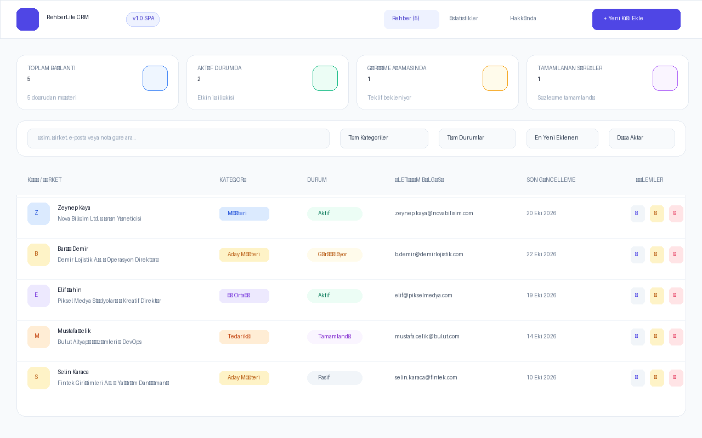

# RehberLite CRM - Müşteri & İletişim Yönetim Uygulaması

> **Web Geliştirme; Javascript Proje Yönergesi** kapsamında geliştirilmiş, modern bileşen tabanlı, kalıcı veri saklama (LocalStorage) özellikli ve Netlify uyumlu CRUD frontend uygulaması.

---

## 📸 Proje Ekran Görüntüsü



---

## 🚀 Canlı Demo & Depo Bağlantıları

- **Canlı Demo (Netlify):** [https://rehberlite-crm.netlify.app/](https://rehberlite-crm.netlify.app/) *(veya kendi Netlify linkiniz)*
- **GitHub Deposu:** [https://github.com/yusufgunce07/crm-app](https://github.com/yusufgunce07/crm-app)

---

## 🎯 Projenin Amacı ve Özellikleri

Bu uygulama; kişisel ve kurumsal müşteri, tedarikçi ve iş ortaklarının iletişim bilgilerini, görüşme notlarını ve süreç aşamalarını pratik bir şekilde yönetmeyi sağlar.

### ✨ Temel Yetenekler & CRUD Operasyonları
1. **Ekle (Create):**
   - Yeni kişi/müşteri ekleme formu.
   - Ad-Soyad, Şirket, Unvan, E-posta, Telefon, Kategori, Durum, Renk Teması ve Özel Notlar.
   - İstemci taraflı form doğrulaması (Zorunlu alanlar ve e-posta format kontrolü).
2. **Listele (Read):**
   - Kart (Grid) veya Tablo (List) görünümü seçeneği.
   - Anlık arama (İsim, şirket, e-posta, not içeriğinde anında filtreleme).
   - Kategoriye göre filtreleme (Müşteri, Aday Müşteri, Tedarikçi, İş Ortağı vb.).
   - Süreç durumuna göre filtreleme (Aktif, Görüşülüyor, Tamamlandı, Pasif).
   - Sıralama (En yeni eklenenler, A'dan Z'ye, Şirket adına göre).
3. **Güncelle (Update):**
   - Kayıtlı kişilerin tüm bilgilerini modal üzerinden düzenleme ve anında kaydetme.
   - Son güncellenme tarihinin otomatik olarak revize edilmesi.
4. **Sil (Delete):**
   - Yanlışlıkla silinmeyi önleyen onay penceresi (Confirmation Modal).
   - LocalStorage'dan güvenli silme ve geri bildirim bildirimi (Toast).
5. **Ekstra Özellikler:**
   - **İstatistik & Metrik Kartları:** Toplam kişi, aktif müşteri ve tamamlanan süreç sayıları.
   - **Analitik Sayfası (StatsPage):** Kategori ve durum dağılımlarını gösteren görsel ilerleme çubukları.
   - **Veri Dışa Aktarma (Export):** Tek tıkla JSON formatında rehber yedeği indirme.
   - **Demo Veri Sıfırlama:** Test işlemlerinde tek tıkla zengin örnek verileri geri getirme butonu.

---

## 🛠️ Kullanılan Teknolojiler

- **Kütüphane / Çerçeve:** React 19 (Vite)
- **CSS / Tasarım:** Tailwind CSS v4
- **İkon Kütüphanesi:** Lucide React
- **Veri Saklama:** HTML5 LocalStorage API (Sunucusuz, kalıcı istemci hafızası)
- **Dağıtım / Hosting:** Netlify (SPA yönlendirme kuralları ile tam uyumlu)

---

## 📁 Proje Klasör Ağaç Yapısı

Yönergede belirtilen **Components**, **Pages** ve **Interfaces** yapısına tam uyumlu mimari:

```text
crm-app/
├── public/                 # Statik dosyalar, favicon ve yönlendirme kuralları
│   ├── _redirects          # Netlify SPA yönlendirme kuralı
│   └── screenshot.png      # Uygulama ekran görüntüsü
├── screenshots/
│   └── screenshot.png      # GitHub README görseli
├── src/
│   ├── components/         # Tekrar kullanılabilir arayüz bileşenleri
│   │   ├── Navbar.jsx              # Üst menü ve hızlı butonlar
│   │   ├── StatsCard.jsx           # Özet metrik kartları
│   │   ├── FilterBar.jsx           # Arama, filtre ve görünüm kontrolleri
│   │   ├── ContactTable.jsx        # Tablo görünümü (Detay/Düzenle/Sil)
│   │   ├── ContactCard.jsx         # Kart/Izgara görünümü
│   │   ├── ContactModal.jsx        # Ekleme ve Güncelleme Form Modalı
│   │   ├── ContactDetailModal.jsx  # Kişi detay çekmecesi
│   │   ├── DeleteConfirmModal.jsx  # Güvenli silme onay penceresi
│   │   └── Toast.jsx               # Otomatik kaybolan işlem bildirimleri
│   ├── pages/              # Sayfa seviyesi görünümler
│   │   ├── ContactsPage.jsx        # Ana rehber ve yönetim sayfası
│   │   ├── StatsPage.jsx           # Detaylı grafik & istatistik sayfası
│   │   └── AboutPage.jsx           # Yönerge ve proje bilgi sayfası
│   ├── interfaces/         # Veri modelleri ve tip kontratları
│   │   └── contactModel.js         # Kişi şeması, sabitler ve varsayılan veri
│   ├── services/           # Kalıcı veri operasyonları (LocalStorage)
│   │   └── storageService.js       # CRUD, JSON export, reset fonksiyonları
│   ├── App.jsx             # Ana durum yönetimi (State)
│   ├── index.css           # Tailwind CSS yapılandırması
│   └── main.jsx            # React başlangıç noktası
├── netlify.toml            # Netlify build ve publish ayarları
├── package.json
└── README.md
```

---

## 💻 Kurulum ve Yerel Ortamda Çalıştırma

Projeyi bilgisayarınızda çalıştırmak için aşağıdaki adımları izleyin:

1. **Depoyu İndirin / Klasöre Girin:**
   ```bash
   cd crm-app
   ```

2. **Bağımlılıkları Yükleyin:**
   ```bash
   npm install
   ```

3. **Geliştirme Sunucusunu Başlatın:**
   ```bash
   npm run dev
   ```
   Tarayıcınızda açmak için terminalde verilen bağlantıya (genellikle `http://localhost:5173`) tıklayın.

4. **Canlıya Alma (Build) Derlemesi:**
   ```bash
   npm run build
   ```
   Çıktı `dist/` klasörüne oluşturulur.

---

## 🌐 Netlify'da Yayına Alma Adımları

1. [Netlify](https://www.netlify.com/) hesabınıza giriş yapın.
2. **Add new site** > **Import an existing project** seçeneğine tıklayın.
3. Projenizi barındıran **GitHub** reponuzu seçin.
4. Yapılandırma ayarlarını kontrol edin:
   - **Base directory:** *(crm-app veya repo kök dizini)*
   - **Build command:** `npm run build`
   - **Publish directory:** `dist`
5. **Deploy Site** butonuna tıklayın. 1-2 dakika içinde projeniz internete açılacaktır!

---

## 📤 GitHub'a Yükleme Adımları

Projeyi kendi GitHub hesabınıza yüklemek için:

```bash
cd crm-app
git init
git add .
git commit -m "feat: RehberLite CRM projesi tamamlandı (React + Tailwind + LocalStorage)"
git branch -M main
git remote add origin https://github.com/yusufgunce07/crm-app.git
git push -u origin main
```

---

## 👨‍🏫 Eğitmen & İletişim Bilgileri

Herhangi bir sorunuz olması durumunda aşağıdaki adres üzerinden iletişime geçebilirsiniz:
- **E-posta:** [softwareonuryalcin@gmail.com](mailto:softwareonuryalcin@gmail.com)
- **Örnek Proje 1:** [https://github.com/ylcnsonur/web-gelistirme-js-sample](https://github.com/ylcnsonur/web-gelistirme-js-sample)
- **Örnek Proje 2:** [https://dnm11remix.netlify.app/](https://dnm11remix.netlify.app/)
